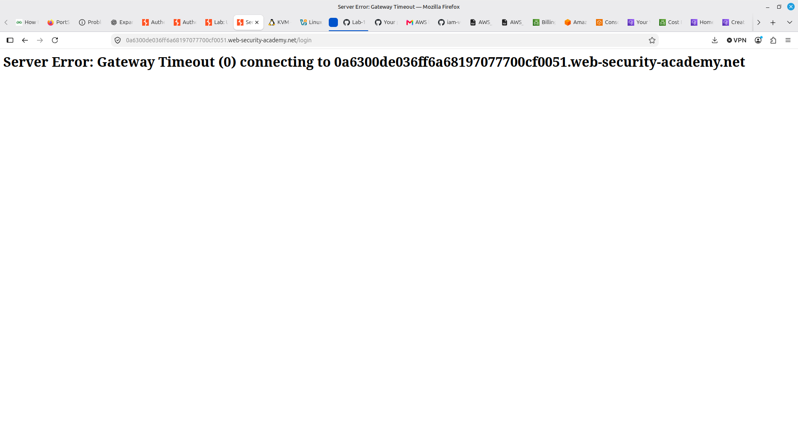
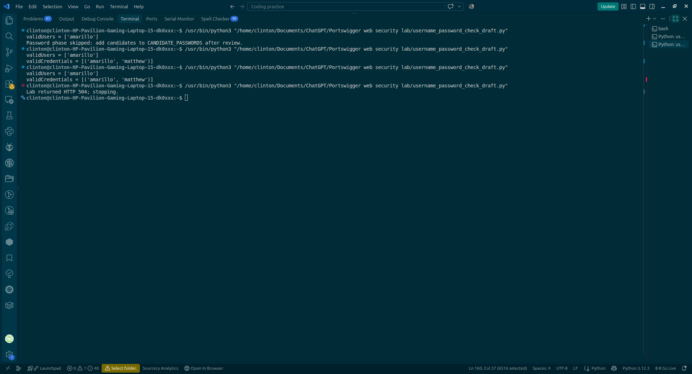

# PortSwigger Web Security Academy

## Lab 1 --- Authentication Vulnerabilities: Username Enumeration via Different Responses

**Report status:** --- Execution Constraints and Session
Lifecycle Update\
**Assessment period:** 1--3 November 2026\
**Target:** PortSwigger Web Security Academy authorised lab\
**Lab:** Username enumeration via different responses\
**Assessment status:** Successfully solved

------------------------------------------------------------------------

## 1. Executive summary

This assessment examined username enumeration through distinguishable
authentication failure responses in a PortSwigger Web Security Academy
lab.

The application returned different error messages depending on whether
the submitted username existed:

-   `Invalid username` for an unrecognised username.
-   `Incorrect password` for a recognised username submitted with an
    incorrect password.

This difference provided a reliable application-level signal for
identifying valid usernames.

The testing process began with manual HTTP inspection in Burp Suite,
followed by a Python implementation using the standard library. The
implementation automated the two-stage process of identifying recognised
usernames and testing password candidates against those usernames.

The final execution identified:

``` python
validUsers = ['amarillo']
validCredentials = [('amarillo', 'matthew')]
```

PortSwigger subsequently displayed the lab's successful completion
message.

A later execution returned HTTP 504. This exposed an operational
limitation: when the lab session expired and a new lab instance URL was
required, the script's hard-coded target URL had to be updated manually.
The current implementation also did not perform a separate initial
session-validation step.

The assessment therefore achieved its primary objective while
identifying session lifecycle management as a future improvement.

## 2. Scope and environment

**Scope:** One individual PortSwigger Academy lab instance.

**Testing environment:** - Operating system: Linux Mint. - Browser and
interception environment: Burp Suite integrated Chromium. - Development
environment: Visual Studio Code. - Python runtime: Python 3.12.3, as
visible in the terminal screenshot. - HTTP implementation: Python
standard library (`urllib`, `http.cookiejar`). - Target: https://portswigger.net/web-security/authentication/password-based/lab-username-enumeration-via-different-responses.

Testing was confined to the authorised lab environment.

## 3. Initial HTTP inspection

The initial evidence-gathering process involved launching the lab,
navigating to `/login`, submitting deliberately invalid credentials, and
inspecting the resulting HTTP traffic.

### 3.1 Initial request

The login page was requested using:

``` http
GET /login HTTP/2
```

The request included a session cookie. The cookie value is intentionally
excluded from this report.

### 3.2 Invalid username response

A POST request was submitted with an unrecognised username and a test
password.

The application returned:

``` http
HTTP/2 200 OK
Content-Length: 3244
```

The response body contained:

``` html
<p class=is-warning>Invalid username</p>
```

### 3.3 Recognised username response

A second request was submitted using a recognised username and an
incorrect password.

The application returned:

``` http
HTTP/2 200 OK
Content-Length: 3246
```

The response body contained:

``` html
<p class=is-warning>Incorrect password</p>
```

### 3.4 Initial observation

The application disclosed whether a username existed through its
authentication error message.

The response-length difference of two bytes was also consistent with the
different message content, but the error-message distinction was the
stronger classification signal.

**Finding F-01:** Username enumeration through distinguishable
authentication failure responses.

The finding demonstrates account-existence disclosure. which
is a more subtle but easily fixable form of authentication bypass or account compromise.
Simply generating a generic user credential failure message for both username and password
while providing a MF authentication upon succesful credentials would resolve the vulnerability.

## 4. Initial Python implementation

The first Python implementation automated username enumeration using a
constant test password.

The script: 1. Created a cookie-aware HTTP opener. 2. Iterated through a
predefined username candidate list. 3. Submitted each candidate to the
login endpoint. 4. Inspected the returned response body. 5. Classified
candidates according to the application's error message. 6. Returned
recognised usernames.

The central classification logic was:

``` python
if "Incorrect password" in body:
    valid_users.append(username)
elif "Invalid username" in body:
    invalid_users.append(username)
else:
    unclassified.append(username)
```

### 4.1 Initial execution

The first execution produced:

``` text
Invalid username responses: 100
validUsers = ['apple']
```

The candidate `apple` was subsequently checked through Burp Repeater.
The application returned `Incorrect password`, independently confirming
that the username was recognised.

This established that the Python implementation was correctly
interpreting the application's response distinction.

## 5. Two-stage implementation

The next iteration extended the original approach to include password
candidate testing.

Rather than treating username enumeration and password testing as
unrelated operations, the implementation orchestrated them sequentially.

### 5.1 Phase one --- Username enumeration

The script submitted a constant, deliberately incorrect password against
each username candidate.

Recognised usernames were retained for the second phase.

### 5.2 Phase two --- Password candidate testing

The script iterated through the password candidate list for each
recognised username.

It classified the response using: - The final URL path, checking for
`/my-account`. - The `Incorrect password` response marker. - The
`Invalid username` response marker. - An unclassified result where the
response did not match the expected conditions.

The script stopped testing further password candidates for a username
after detecting a successful login.

### 5.3 Session continuity within an execution

The implementation used a single cookie-aware opener for both phases:

``` python
opener = build_opener(HTTPCookieProcessor(CookieJar()))
```

This opener was passed through the username enumeration and password
testing functions.

Consequently, cookies received during the first phase could be retained
and reused during the second phase. This provided session continuity
within an individual script execution.

It did not, however, automatically discover a replacement lab URL or
preserve a session across a newly launched lab instance.

## 6. Implementation reasoning and pseudocode

The principal design decision was to separate candidate identification
from credential testing.

This reduced unnecessary password requests because the second phase only
operated on usernames already recognised by the application.

### 6.1 Pseudocode

``` text
INPUT:
    candidate_users
    candidate_passwords
    login_endpoint
    constant_test_password

INITIALISE:
    valid_users = []
    invalid_users = []
    valid_credentials = []

FUNCTION classify_response(response):
    IF response redirects to account page:
        RETURN LOGIN_SUCCESS
    ELSE IF response contains "Incorrect password":
        RETURN VALID_USERNAME
    ELSE IF response contains "Invalid username":
        RETURN INVALID_USERNAME
    ELSE:
        RETURN UNCLASSIFIED

PHASE 1 — USERNAME ENUMERATION:

    FOR each username IN candidate_users:

        response = submit_login(
            username,
            constant_test_password
        )

        classification = classify_response(response)

        IF classification == VALID_USERNAME:
            append username to valid_users

        ELSE IF classification == INVALID_USERNAME:
            append username to invalid_users

        ELSE:
            record unclassified response

PHASE 2 — PASSWORD CANDIDATE TESTING:

    FOR each username IN valid_users:

        FOR each password IN candidate_passwords:

            response = submit_login(username, password)

            classification = classify_response(response)

            IF classification == LOGIN_SUCCESS:
                append (username, password)
                    to valid_credentials

                BREAK

            ELSE:
                continue testing candidates

OUTPUT:
    valid_users
    valid_credentials
    unclassified responses
```

### 6.2 Comparison with the PortSwigger reference procedure

The reference procedure uses Burp Intruder to submit username
candidates, inspect response differences, and then test password
candidates against recognised usernames.

The Python implementation reproduced the underlying testing logic while
automating candidate iteration and response classification.

The implementation was more autonomous in execution, but not fully
autonomous: the candidate lists, target URL, and execution initiation
remained user-controlled.

The password-testing stage detects success through the final URL path `/my-account` after Python's
HTTP handling rather than explicitly inspect an HTTP 302 status code as
the desired lab evaluation condition.

## 7. Execution results

The following results were observed chronologically.

### 7.1 Initial username enumeration

``` text
validUsers = ['apple']
```

Burp Repeater subsequently confirmed the `Incorrect password` response
for this candidate.

### 7.2 First two-stage execution

One execution was performed while the password candidate list was empty.

The script correctly reported:

``` text
validUsers = ['amarillo']
Password phase skipped: add candidates to CANDIDATE_PASSWORDS after review.
```

This demonstrated that the username enumeration phase could complete
independently of the password phase.

### 7.3 Successful two-stage execution

After password candidates were supplied, the script produced:

``` text
validUsers = ['amarillo']
validCredentials = [('amarillo', 'matthew')]
```

The PortSwigger Academy interface subsequently displayed:

**Congratulations, you solved the lab!**

This is the definitive completion result for Lab 1.

### 7.4 Repeated execution

The terminal evidence also shows a subsequent execution returning the
same recognised username and credential result:

``` text
validUsers = ['amarillo']
validCredentials = [('amarillo', 'matthew')]
```

The repeated result provides additional evidence that the implementation
could reproduce the successful outcome while the relevant lab instance
remained available.

## 8. New finding --- Session expiry and target URL management

### 8.1 Observed operational constraint

During repeated testing, the lab session expired. A replacement lab
session required a new lab URL to be supplied to the script manually.


The target URL was hard-coded in the Python implementation:

``` python
LOGIN_URL = "https://...web-security-academy.net/login"
```

As a result, when a new lab instance was launched, the script could
continue pointing to the previous instance unless the URL was updated.

The user also had to manually provide the new URL when the session
expired.

### 8.2 HTTP 504 execution result

A later execution returned:

``` text
Lab returned HTTP 504; stopping.
```

The terminal screenshot records this after earlier successful
executions.


The script stopped rather than interpreting the gateway error as a valid
or invalid username/password result. Which was the intended behaviour for
an unclassified infrastructure failure.

The 504 is consistent with the session or lab instance no longer being
available, along with `Server Error: Gateway Timeout (0) connecting to 0a6300de036ff6a68197077700cf0051.web-security-academy.net`

### 8.3 Existing session handling versus missing lifecycle handling

The implementation already used `CookieJar` and `HTTPCookieProcessor`.

This means it could maintain cookies received during its own execution.
The limitation was not a complete absence of cookie handling.

The missing functionality was at the session lifecycle level:

-   No dedicated initial GET request to establish a session before
    testing.
-   No explicit validation that the supplied lab URL still referred to
    an active instance.
-   No automated discovery of a replacement lab hostname.
-   No controlled restart or reinitialisation workflow after expiry.
-   The target URL remained a manually maintained configuration value.

The script must also establish and retain a usable session with the new instance.

### 8.4 Proposed improvement --- Session initialisation

A future version should introduce a distinct initialisation stage:

``` text
INPUT:
    active_lab_url

INITIALISE:
    create cookie-aware HTTP opener

SESSION INITIALISATION:

    request GET /login using active_lab_url

    capture session cookies

    verify expected login page response

    IF session initialisation fails:
        stop execution
        report session or connectivity failure

EXECUTION:

    run username enumeration

    run password candidate testing
    using the same opener and session

ERROR HANDLING:

    IF gateway or server error occurs:
        stop execution
        report execution interruption
        do not classify it as an authentication result
```

This would remove the need to manually manage session cookies and ensure
that the script establishes its own session before testing.

It would not eliminate the need to supply a new lab URL when PortSwigger
creates a replacement instance. Automated URL discovery would be a
separate enhancement and has been implemented here `username_password_algorithm.md`.

## 9. Complexity and performance considerations

Let:

-   \(m\) represent the number of username candidates.
-   \(n\) represent the number of password candidates.
-   \(v\) represent the number of recognised usernames.

Username enumeration requires approximately (m) HTTP requests, giving:

\[ O(m) \]

Password candidate testing requires up to (v `\times `{=tex}n) requests:

\[ O(vn) \]

The combined worst-case request complexity is:

\[ O(m + vn) \]

For one recognised username, the password phase scales linearly with the
number of password candidates:

\[ O(n) \]

Also should Note that Network latency, server response time, redirects, and session
availability also affect execution duration.

## 10. Evidence register

  -----------------------------------------------------------------------------------------
  ID                      Evidence                Description
  ----------------------- ----------------------- -----------------------------------------
  E-01                    Initial GET request     Captured login-page request and session
                                                  context.

  E-02                    Invalid username        HTTP 200 response containing
                          response                `Invalid username`.

  E-03                    Recognised username     HTTP 200 response containing
                          response                `Incorrect password`.

  E-04                    Initial Python          Username enumeration output identifying
                          execution               `apple`.

  E-05                    Burp Repeater           Independent response validation for
                          validation              `apple`.

  E-06                    Two-stage Python        Code supplied for username enumeration
                          implementation          and password candidate testing.

  E-07                    Successful two-stage    Output identifying `amarillo` and
                          execution               `matthew`.

  E-08                    Academy solved          Original file:
                          screenshot              `username enumeration Lab solved .png`.
                                                  Shows the lab completion message.

  E-09                    Python execution        Original file:
                          screenshot              `output results of script.png`. Shows the
                                                  development environment and successful
                                                  execution output.

  E-10                    Session-expiry          Original file:
                          execution screenshot    `session expiration execution.png`. Shows
                                                  the earlier successful runs, the
                                                  password-phase skip when the candidate
                                                  list was empty, repeated successful
                                                  output, and the later HTTP 504
                                                  interruption. Implemented design solution
                                                  failure point can be found here: username_password_algorithm.md
  -----------------------------------------------------------------------------------------

**Evidence handling:** Original filenames are retained. The E-10
screenshot is supplementary evidence of execution behaviour and the
session-expiry constraint.

## 11. Constraints and limitations

The following limitations were identified:

1.  The target lab URL is hard-coded and requires manual updating when a
    replacement instance is launched.
2.  Session cookies are maintained within a script execution, but there
    is no explicit session initialisation or validation stage.
3.  A 504 response interrupts execution and requires investigation
    rather than candidate classification.
4.  Candidate generation and candidate ordering remain dependent on
    externally supplied lists.
5.  Response classification relies on known textual markers and the
    expected account-page path.
6.  The script does not yet export structured execution logs containing
    timestamps, response status, response length, final URL, and
    classification.
7.  The implementation has not been tested against a broad range of
    session-expiry, timeout, or transient server-failure conditions.

## 12. Future optimisation register

The following items are planned and have not been implemented:

-   Configurable candidate generation, including ASCII candidate sets.
-   Search-space modelling and probability-weighted candidate ordering.
-   Improved dictionary quality and ordering.
-   Performance modelling, including request rate and evaluation time.
-   Structured response metadata and evidence exports.
-   Modular separation of candidate generation, ordering, HTTP
    submission, classification, storage, and evidence.
-   Reproducible execution configuration and reporting.


## 13. Security finding and remediation

**F-01 --- Username enumeration through different authentication
responses**

**Observation:** The application returned `Invalid username` for
unrecognised usernames and `Incorrect password` for recognised
usernames.

**Impact:** An attacker could use the difference to identify valid
accounts, reducing uncertainty before attempting password attacks.

**Recommended remediation:** - Return a consistent authentication
failure message regardless of whether the username exists. - Ensure
response behaviour does not reveal account validity through other
distinguishable characteristics. - Apply appropriate rate limiting and
monitoring to authentication attempts. - Consider additional controls
against automated credential attacks.

No remediation or retest was performed as part of this lab.

## 14. Conclusion

Lab 1 was successfully completed.

The assessment progressed from manual HTTP inspection to a Python
implementation capable of performing username enumeration and password
candidate testing in sequence. The final execution identified a valid
username and password, and the Academy confirmed the lab was solved.

The later HTTP 504 exposed an operational limitation in the current
implementation: the lab URL had to be manually updated when a session
expired and a replacement instance was launched. Although cookie
handling was implemented within each execution, explicit session
initialisation and lifecycle management were not.

The next engineering improvement is therefore to separate session
initialisation and validation from the enumeration logic, preserving the
existing successful baseline while improving execution reliability.

**Final assessment status:** Lab solved. Session lifecycle improvement
identified and implemented at:`username_password_algorithm.md`.
